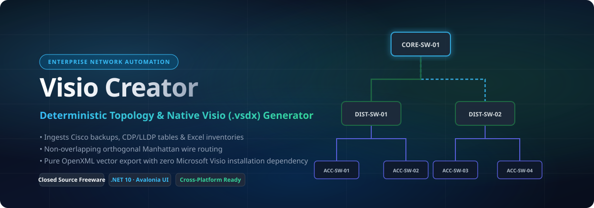

<div align="center">

<br>


# Visio Creator

### Enterprise Campus Network Topology Engine & Native Microsoft Visio (.vsdx) Generator

<br>

[](https://github.com/LazyAutomatar/Visio-Creator/releases)
[](LICENSE.md)
[](LICENSE.md)
[](https://github.com/LazyAutomatar/Visio-Creator/releases)
[](https://github.com/LazyAutomatar/Visio-Creator/releases)
[](https://dotnet.microsoft.com/)

<br>

[**Download**](#download) · [**Features**](#features) · [**Screenshots**](#screenshots) · [**Supported Hardware**](#supported-hardware) · [**Ingestion Guide**](#telemetry--ingestion-guide) · [**Changelog**](#changelog) · [**Feedback & Issues**](#feedback--support) · [**License & EULA**](#license)

<br>

<a href="https://github.com/LazyAutomatar/Visio-Creator/releases"></a>
<a href="https://github.com/LazyAutomatar/Visio-Creator/releases"></a>
<a href="https://github.com/LazyAutomatar/Visio-Creator/releases"></a>
<a href="https://github.com/LazyAutomatar/Visio-Creator/releases"></a>

</div>

> [!IMPORTANT]
> **Read-Only & Offline Assurance**: Visio Creator operates completely offline and read-only. It parses standard Cisco CLI backup logs, CDP/LLDP neighbor tables, and inventory spreadsheets. The application executes zero configuration changes or write transactions against network devices.

---

<div align="center">

</div>

---

## <a id="screenshots"></a>Screenshots & Visual Previews
<sub>Drop your application screenshots into <code>assets/screenshots/</code> to replace preview cards below.</sub>

| 🗺️ Interactive Vector Topology Canvas | 📐 Native Microsoft Visio (.vsdx) Output |
| :---: | :---: |
| <br><sub><em>Draggable nodes, marquee group-selection, wire-centered port badges, and orthogonal bus routing</em></sub> | <br><sub><em>100% Genuine OpenXML Visio drawing with 2-D connection points and dynamic stencils</em></sub> |

---

## <a id="features"></a>Features

### 🗺️ Multi-Tier Campus Topology Engine
* **Automated Campus Hierarchy** — Automatically classifies nodes into **Tier 1 (Core)**, **Tier 2 (Distribution)**, **Tier 3 (Access)**, **Endpoints/APs**, and **External/Perimeter** layers.
* **Orthogonal Manhattan Wire Routing** — Non-overlapping right-angle routing with dedicated corridor separation, eliminating wire crossing and shape collisions across high-density enterprise switches.
* **Deterministic Location Grouping** — Intelligently groups access switches and edge devices into regional location containers with bounded coordinate geometry.
* **Strict Topological Provenance** — Preserves physical parallel links while cleanly deduplicating reciprocal CDP/LLDP observations across devices without synthesizing fake data.

### 📐 Native OpenXML Microsoft Visio (.vsdx) Exporter
* **Zero External Software Dependencies** — Directly generates 100% standards-compliant OpenXML `.vsdx` drawings without requiring Microsoft Visio to be installed on the machine.
* **Dynamic Connectors & 2-D Connection Points** — Creates genuine Visio dynamic connectors with right-angle routing and snapped connection points on shape boundaries.
* **Dual Companion Labels** — Formats dual-text labels beneath each device shape (bold device hostname and management IP address).
* **Configurable Master Stencils (`.vssx`)** — Seamlessly embeds official custom network master stencils with customizable JSON role-to-master mappings.
* **Auto-Oriented Page Sizing** — Calculates exact diagram bounding boxes with generous margin padding to produce perfectly framed Visio sheets.

### 🎨 Native Diagrams.net (Draw.io) Exporter
* **Complete Layout Parity** — Generates genuine `.drawio` XML files preserving the exact coordinates, bounding boxes, and tier structures arranged on the canvas.
* **Terminal-Anchored Port Labels** — Edge port labels are exported with terminal anchors (`x="-1"` for source, `x="1"` for target) and directional offsets, guaranteeing labels stay attached to ports when shapes are moved inside Draw.io.
* **Synchronized Color Palette** — Sky Blue for copper links, Gold for fiber uplinks, Purple for Port-Channels, Emerald for AP connections, and Amber for IP telephony.

### 💻 Interactive Desktop Experience (Avalonia UI 11.2)
* **Virtual Infinite Workspace** — Fluid canvas with cursor-centered zoom, pan, and real-time bounding box expansion as nodes are repositioned.
* **Multi-Node Marquee Selection** — Box-select multiple nodes simultaneously with synchronized group dragging across all selected devices.
* **Pixel-Perfect Port Badge Alignment** — Vertical links display vertical badges rotated +90° reading cleanly from top to bottom; horizontal badges are centered with tight text-wrapping.
* **Collapsible Device Tree Panel** — One-click show/hide toggle collapses the 240px Network Topology sidebar to maximize canvas viewing area.
* **Full-Screen Workspace (`F11` / `Escape`)** — Toggle in and out of immersive full-screen diagramming mode with dedicated toolbar indicators.
* **Theme System Parity** — Title bar rounded pill toggle (`Highlight` sun / `DarkTheme` moon) with global dynamic styling across Dark, Light, and System themes.

### 🔄 In-App Auto-Updates & Enterprise Security
* **One-Click Update Checker** — Checks the official release manifest on GitHub from the **About** view and installs updates in one click.
* **In-Place Upgrade & Progress** — Streams update installer packages with live progress bars and transparent status messaging.
* **Cryptographic Verification** — Validates downloaded binary SHA-256 hashes against trusted release manifests prior to staging or execution.
* **PE Header Safety Interceptor** — Validates Win32 executable magic byte signatures (`MZ`) before staging or running setup.
* **Authenticode Digital Signatures** — Windows packages and installers are Authenticode-signed with exported certificates for security inspection.
* **In-App Release History Viewer** — Expandable changelog and release notes viewer directly inside the application.

---

## <a id="download"></a>Download & Installation

Get the latest release for your operating system from the official [**GitHub Releases**](https://github.com/LazyAutomatar/Visio-Creator/releases) page:

| Platform | Package | Architecture | Description |
| :--- | :--- | :--- | :--- |
| **Windows** | `VisioCreator.exe` | x64 (64-bit) | Portable single-file standalone binary (no installation required) |
| **Windows** | `VisioCreator_Setup.exe` | x64 (64-bit) | Windows Setup Wizard with Desktop shortcut and uninstaller |
| **Windows** | `VisioCreator-win-x64.zip` | x64 (64-bit) | Portable zip archive containing binary and assets |
| **macOS** | `VisioCreator-osx-arm64.zip` | Apple Silicon (M1/M2/M3/M4) | Native `.app` bundle optimized for Apple Silicon |
| **macOS** | `VisioCreator-osx-x64.zip` | Intel x64 | Native `.app` bundle for Intel Macs |
| **Linux** | `VisioCreator-linux-x64.tar.gz` | x64 (AMD64) | Tarball package for Linux x64 desktops and servers |
| **Linux** | `VisioCreator-linux-arm64.tar.gz` | ARM64 (aarch64) | Tarball package for ARM64 Linux systems |

### Quick Start by Operating System

#### Windows
Download `VisioCreator.exe` and double-click to launch immediately. Alternatively, download and run `VisioCreator_Setup.exe` for system integration with Start Menu and Desktop shortcuts.

#### macOS
1. Download `VisioCreator-osx-arm64.zip` (for Apple Silicon) or `VisioCreator-osx-x64.zip` (for Intel Macs).
2. Extract the archive and drag `VisioCreator.app` into your `/Applications` folder.
3. If macOS displays an unidentified developer prompt on first launch, open Terminal and run:
   ```bash
   xattr -cr /Applications/VisioCreator.app
   ```

#### Linux
1. Download and extract the archive:
   ```bash
   tar -xzf VisioCreator-linux-x64.tar.gz
   cd VisioCreator-linux-x64
   chmod +x VisioCreator
   ./VisioCreator
   ```

---

## <a id="supported-hardware"></a>Supported Hardware & Platforms

Visio Creator ingests and classifies telemetry from modern and legacy enterprise campus and data center platforms:

* **Core & Spine Switches**: Cisco Catalyst 9600, 9500, 9400, 6800, 6500 series, Cisco Nexus 9000/7000/5000.
* **Distribution Layer**: Cisco Catalyst 9300, 9300X, 3850, 3650, 4500-E series.
* **Access Layer**: Cisco Catalyst 9200, 9200L, 9200CX, 2960-X, 2960-XR, 3560-CX, Catalyst 1000, Cisco CBS/SG series.
* **Wireless LAN Controllers**: Cisco Catalyst 9800 Series (9800-80, 9800-40, 9800-L, 9800-CL), Cisco 5520, 3504 AireOS.
* **Campus Access Points**: Cisco Catalyst 9100 Series (9105, 9115, 9120, 9130, CW9162/64/66), Cisco Aironet 2800/3800/4800.
* **Routers & WAN Edges**: Cisco Catalyst 8300/8200, ISR 4000 series, ASR 1000 series.
* **Endpoints & Telephony**: Cisco IP Phones (7800, 8800 series), Video conference codecs, networked printers.

---

## <a id="telemetry--ingestion-guide"></a>Telemetry & Ingestion Guide

For **offline diagramming**, collect standard read-only command outputs from your network switches and save them into `.txt` or `.log` files:

```text
show running-config
show cdp neighbors detail
show cdp neighbors
show lldp neighbors detail
show lldp neighbors
show ip interface brief
show inventory
```

> [!TIP]
> **Flexible File Ingestion**: You can drop a single concatenated log file, a directory of individual `.log`/`.txt` files, or a `.zip` archive containing configuration backups. The parser automatically detects hostnames, IP addresses, neighbor tables, and interface pairings across multiple backup formats.

---

## <a id="changelog"></a>Changelog & Release History

Official production releases and package distributions are hosted on [LazyAutomatar/Visio-Creator](https://github.com/LazyAutomatar/Visio-Creator).

### [1.0.0] - 2026-11-07 (Official Production Release)
* **Network Health Reporter UI/UX Parity & Modernization**:
  - **Skia Vector Canvas Parity**: Styled with card fill brush, top accent role stripes (5px), dual-end wire badges, and Manhattan routing matching NetHealth.
  - **FluentAvalonia Hamburger Navigation**: LeftCompact sidebar (48px collapsed, 220px expanded) with anchored About & System section.
  - **Native FullScreen Handler**: `F11` / `Escape` keyboard shortcuts and canvas toolbar toggle.
  - **Exclusive Monospace Diagnostic Logging**: Application logs consolidated exclusively into About view with Clear, Copy, and Open Folder actions.
  - **In-App Auto-Updates**: One-click update check, silent background download, SHA-256 verification, and PE header magic-byte validation.
  - **Device Tree Toggle**: Canvas toolbar button collapsing/expanding the 240px topology sidebar.
  - **Theme System**: Title bar rounded pill toggle across Dark, Light, and High-Contrast themes.
  - **Virtual Infinite Canvas**: Multi-node marquee box selection, synchronized group dragging, and cursor-centered zoom.
  - **Pixel-Perfect Port Badges**: Rotated +90° vertical badges on vertical links and centered badges on horizontal links.
  - **Draw.io Terminal Anchoring**: Edge labels exported with `relative="1"` terminal offsets locking labels to ports when moved in diagrams.net.
  - **Multi-Platform Automated Pipeline**: Cross-compiler pipeline producing standalone binaries, portable archives, and Inno Setup Windows installers.

> Complete change history is tracked in [CHANGELOG.md](CHANGELOG.md).

---

## <a id="feedback--support"></a>Feedback & Issue Reporting

Visio Creator is a closed-source freeware tool maintained for the network engineering community. While the source codebase is proprietary, the software is public and **100% free for everyone**.

1. **Report Bugs & Regressions:** Open a ticket on our [GitHub Issue Tracker](https://github.com/LazyAutomatar/Visio-Creator/issues).
2. **Request Hardware & Stencil Support:** If you have newer switch models or specific vendor hardware, submit sanitized CLI output snippets via GitHub Issues.
3. **Feature Requests:** Share ideas for new layout heuristics, export formats, or diagram styles.

---

## <a id="license"></a>License & Terms of Use

Visio Creator is provided as **Closed Source Freeware — Free for Personal and Commercial Enterprise Use**.

You are free to download, install, run, and distribute unmodified binary copies of this software across your organization without license fees or subscription costs. See [LICENSE.md](LICENSE.md) and [EULA.txt](EULA.txt) for complete terms of use.

**Author & Engineering:**
- **Lead Engineer**: [Yash Nalawde](https://www.linkedin.com/in/yash-nalawde)
- **GitHub Profile**: [@Majordean0303](https://github.com/Majordean0303)
- **Official Distribution**: [LazyAutomatar/Visio-Creator](https://github.com/LazyAutomatar/Visio-Creator)

<div align="center">
<br>
<sub>Crafted with precision for enterprise network engineering teams worldwide.</sub>
</div>
